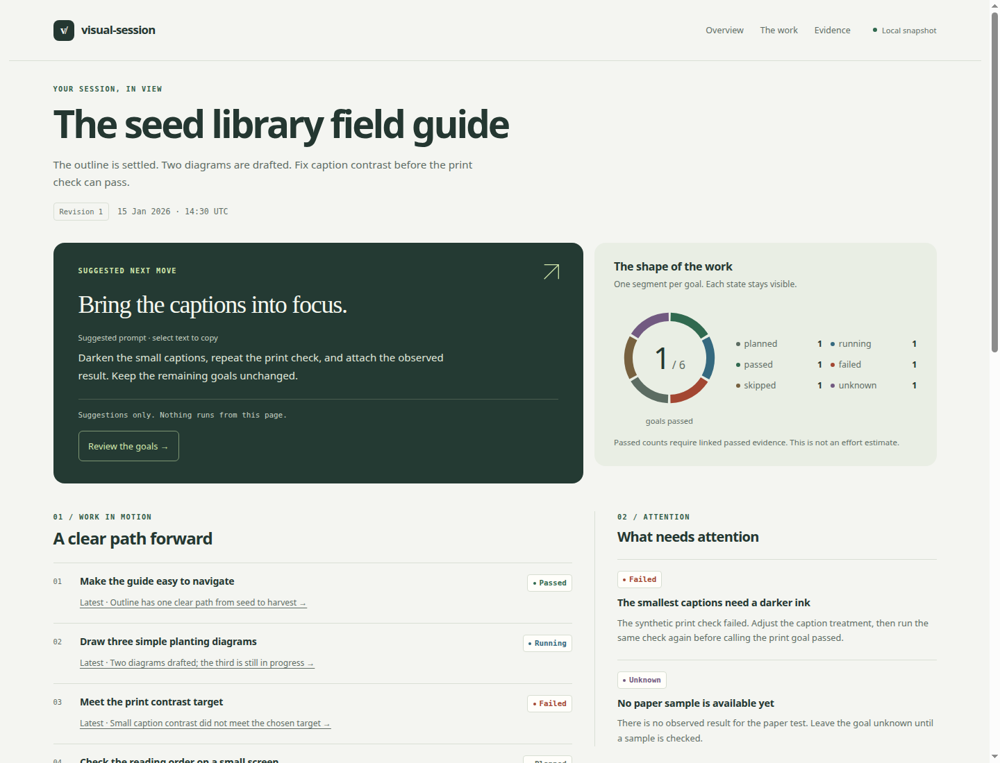

# visual-session

A quiet, visual companion for an ongoing agent session. Keep the goal, observed progress, evidence, blockers, and useful next moves together in one responsive HTML page.

The skill maintains a structured local state file and updates the same dashboard. A small Rust renderer handles validation, safe text rendering, and preservation of user edits. No server, JavaScript, telemetry, hosted service, or background agent is involved.

## Try the synthetic demo

Download and open [examples/demo.html](examples/demo.html) in a browser. It is a self-contained snapshot of a fictional seed-guide session. All example results and decisions are synthetic. The [initial state](examples/session.json) and [updated checkpoint](examples/session-updated.json) show how evidence changes a goal from failed to passed.

The page leads with one useful next prompt. A linked ring gives every goal a place, while a compact work list connects status to evidence. Context and loop guidance sit together, and a newest-first evidence trail keeps the observations visible. Counts describe recorded goal states, not remaining effort or a confidence score.



[See the mobile preview](examples/mobile.png). The HTML itself adapts to your screen; these are actual browser captures of the synthetic demo.

## Install the skill

Clone this repository, then copy the complete `skills/visual-session` directory into your agent's supported skill directory. For Codex's usual local directory:

```sh
git clone https://github.com/jpleva91/visual-session.git
mkdir -p "$HOME/.codex/skills"
cp -R visual-session/skills/visual-session "$HOME/.codex/skills/visual-session"
```

Keep an existing installation safe: inspect and reconcile it before copying over the same directory. Other agents can load [SKILL.md](skills/visual-session/SKILL.md) directly when they support instruction-based skills. This repository does not install itself or change agent configuration.

Use an existing stable Rust toolchain with Cargo. Build the installed renderer once; this explicitly downloads the locked crates if they are not cached:

```sh
CARGO_BUILD_JOBS=1 cargo build --locked \
  --manifest-path "$HOME/.codex/skills/visual-session/scripts/renderer/Cargo.toml"
```

Then ask your agent:

> Use $visual-session to create a local dashboard for this session from the goals and evidence we already have. Suggest the next useful prompt, context to carry forward, and one bounded loop.

Or later:

> Update the same visual-session dashboard with the new observed result. Keep my notes and the existing artifact identity.

## Run the renderer directly

From this repository, create and update a disposable, synthetic preview:

```sh
umask 077
mkdir -p .visual-session
CARGO_BUILD_JOBS=1 cargo run --offline --locked \
  --manifest-path skills/visual-session/scripts/renderer/Cargo.toml -- \
  validate examples/session.json
CARGO_BUILD_JOBS=1 cargo run --offline --locked \
  --manifest-path skills/visual-session/scripts/renderer/Cargo.toml -- \
  render examples/session.json .visual-session/dashboard.html
# Open .visual-session/dashboard.html; add a margin note outside the generated markers.
CARGO_BUILD_JOBS=1 cargo run --offline --locked \
  --manifest-path skills/visual-session/scripts/renderer/Cargo.toml -- \
  render examples/session-updated.json .visual-session/dashboard.html
```

For a real session, save state privately as `.visual-session/state.json`. This repository ignores that directory; in other projects, ensure local Git exclusion **before** saving real data. The renderer does not create directories, edit Git policy, collect session history, or write state for you. Your agent creates and merges state using the [contract](skills/visual-session/references/state-contract.md).

State schema version 1 requires a stable `id`, increasing `revision`, snapshot `as_of`, goals, evidence, blockers, suggestions, and notes. Every status is one of `planned`, `running`, `passed`, `failed`, `skipped`, or `unknown`. A passed goal must link passed evidence, and evidence records its source and observation time. Validation checks consistency, not the truth of supplied observations.

## Safe updates and local privacy

- Rendering to a new path creates a page. Rendering to the same path updates its managed session region. Identity mismatches, stale revisions, arbitrary existing files, edited generated regions, symlink outputs, busy locks, and HTML over 8 MiB are refused.
- HTML outside the managed region survives byte for byte, including margin notes, styles, and the browser-tab title. The visible session title comes from the current state. New pages use layout 2; earlier pages retain their original markup and styles on update. A redesign migration requires deliberate reconciliation.
- The edit-detection checksum prevents accidental clobbering; it is not an authentication mechanism. Locks coordinate this tool's writers, not arbitrary external editors. Close concurrent editors while rendering.
- Text is escaped, optional evidence links allow a conservative subset of HTTPS, and the page blocks scripts and network assets with a Content Security Policy. Clicking an evidence link deliberately visits that destination.
- Unix output files are created with mode `0600`. Secure the state and directory yourself; other systems use their normal file permissions. Exclusion is not encryption or protection against cloud sync.
- Recommendations grant no execution authority. They invoke no skill, run no command, retry no operation, and schedule nothing.

Do not copy credentials, hidden instructions, transcripts, personal data, customer data, or internal operational details into public examples. The renderer cannot classify confidential content. See [local workflow and conflict handling](skills/visual-session/references/local-workflow.md).

## Development and verification

All supporting executable code is Rust. The renderer's only direct dependency is `serde_json`, pinned in `Cargo.toml`; registry versions and checksums are recorded in `Cargo.lock`. The active graph and upstream license/repository information are documented in [DEPENDENCIES.md](DEPENDENCIES.md).

```sh
cargo fmt --manifest-path skills/visual-session/scripts/renderer/Cargo.toml --check
CARGO_BUILD_JOBS=1 cargo clippy --offline --locked \
  --manifest-path skills/visual-session/scripts/renderer/Cargo.toml --all-targets -- -D warnings
CARGO_BUILD_JOBS=1 cargo test --offline --locked \
  --manifest-path skills/visual-session/scripts/renderer/Cargo.toml
```

Tests cover deterministic rendering, create/update behavior, preserved user edits, collision and revision refusals, injection attempts, invalid links, status/evidence validation, timestamps, output permissions, lock behavior, prompt priority, chronological evidence, goal-ring semantics, and compatibility with original dashboards. Regenerate `examples/demo.html` from the initial fixture after template changes; never use real state for a committed demo.

The redesigned demo was rendered and visually reviewed in installed Chrome 149 at 320, 390, 768, 1024, and 1440px with the browser sandbox enabled. The review included the updated checkpoint. Contrast tests check known text/background pairs and the dark-panel focus outline; CSS respects reduced-motion preferences. This is not a complete screen-reader or cross-browser accessibility audit.

The MVP has no transcript ingestion, automatic monitoring, browser-side state editing, Markdown/HTML interpolation, arbitrary local evidence links, or agent orchestration. Its output is a snapshot, and evidence can become stale after a relevant change.

MIT licensed. Contributions should keep the skill small, local, portable, and testable.
